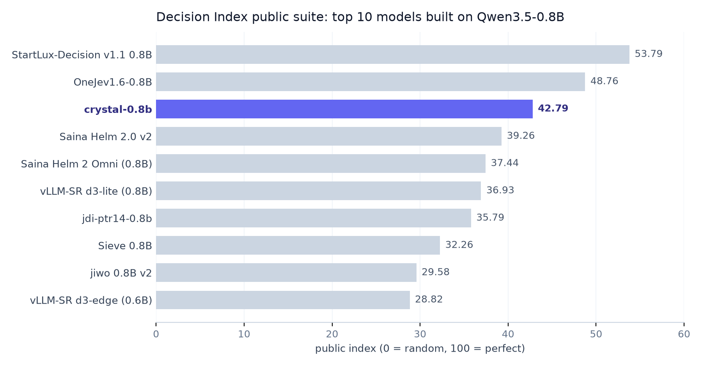

# crystal-0.8b

<div style="text-align: center">
  
  <p>
    <a href="https://huggingface.co/Qwen/Qwen3.5-0.8B">🧱 Base Model</a> |
    <a href="https://huggingface.co/spaces/multimodalart/jev-decision-index">📊 Decision Index</a> |
    <a href="https://huggingface.co/Kyunghwan-kim/crystal-0.8b/tree/main/crystal">💻 Code</a> |
    <a href="https://huggingface.co/Kyunghwan-kim/crystal-0.8b/blob/main/TRAINING_DATA.md">📄 Training Data</a>
  </p>
</div>

**crystal-0.8b** is a 0.8B decision model. Give it a state (text or JSON) and questions, either multiple choice (`choice`) or yes/no (`noul`). It returns a probability for every option. It generates no text, and each question takes one forward pass of about 30 ms.

- **Base:** [Qwen3.5-0.8B](https://huggingface.co/Qwen/Qwen3.5-0.8B), fine-tuned on gold labels from 113 public sources ([list](TRAINING_DATA.md)) and merged back with the base.
- **Inputs:** text or JSON. Questions have 2–255 options. Several questions about the same state run in one call.

## Performance

The Decision Index public suite has 37 benchmarks in five areas, each scored from 0 (random) to 100 (perfect). The board lists 18 models built on Qwen3.5-0.8B. crystal-0.8b would place third among them, ahead of d3-lite in every area and behind StartLux v1.1 and OneJev1.6. The figure shows the top ten, and the other nine score between 11.8 and 25.8.

<div style="text-align: center">
  
</div>

| Model | Public | Knowledge | Language | Retrieval | Tools | Arts | Full (private) |
|:--|:--:|:--:|:--:|:--:|:--:|:--:|:--:|
| [StartLux-Decision v1.1 0.8B](https://huggingface.co/startlux-models/StartLux-Decision-v1.1-0.8B-Instant) | **53.79** | **28.5** | **55.5** | **66.5** | **74.6** | **51.1** | 28.88 |
| [OneJev1.6-0.8B](https://huggingface.co/OmniJev/OneJev1.6-0.8B) | 48.76 | 26.1 | 48.1 | 63.4 | 72.9 | 35.6 | 29.58 |
| **crystal-0.8b** | 42.79 | 19.1 | 44.8 | 55.4 | 64.9 | 33.4 | – |
| [Saina Helm 2.0 v2](https://huggingface.co/run-saina/saina-helm-2-0.8b) | 39.26 | 16.6 | 44.0 | 50.5 | 61.3 | 22.5 | 25.29 |
| [vLLM-SR d3-lite](https://huggingface.co/vllm-sr/d3-lite) | 36.93 | 18.6 | 34.2 | 53.7 | 56.3 | 22.3 | 26.16 |

Other models' scores come from the board (Decision Index 0.4.1, 22 Oct 2026). crystal-0.8b's come from our own run of the board's public kit. It has not been submitted yet, so it has no Full score. Full is the board's ranking score and comes from private tests only.

### Results by benchmark

Each benchmark's own metric × 100, before chance correction. The best of the five in each row is in bold.

| Benchmark | Metric | crystal-0.8b | StartLux v1.1 | OneJev1.6 | Saina Helm 2.0 v2 | d3-lite |
|:--|:--|:--:|:--:|:--:|:--:|:--:|
| ***Knowledge*** | |  |  |  |  |  |
| GPQA Diamond | accuracy | **34.2** | 30.1 | 28.6 | 24.5 | 33.2 |
| GSM8K | accuracy | 37.6 | 37.7 | 34.8 | 34.6 | **41.6** |
| ChessBench | accuracy | 8.9 | 21.2 | 19.8 | **21.8** | 8.3 |
| MuSR | accuracy | 58.5 | 59.7 | **71.8** | 54.9 | 57.9 |
| SATA-Bench | case exact accuracy | 22.5 | **50.6** | 32.7 | 14.2 | 19.6 |
| CRUXEval | accuracy | 30.2 | 34.7 | **36.8** | 30.9 | 33.7 |
| CLadder | accuracy | 58.9 | 79.5 | **82.1** | 76.5 | 61.1 |
| HLE | accuracy | 12.8 | 12.8 | 12.8 | 13.6 | **14.4** |
| MMLU-Pro | accuracy | **34.1** | 33.4 | 29.2 | 24.7 | 32.5 |
| BBH | accuracy | 52.5 | **71.5** | 66.8 | 42.9 | 46.6 |
| WinoGrande | accuracy | 69.4 | 70.6 | 64.7 | 62.4 | **70.9** |
| ***Language*** | |  |  |  |  |  |
| ContractNLI | macro-F1 | 83.8 | 84.4 | 82.7 | **85.4** | 54.2 |
| ANLI | macro-F1 | 50.1 | **57.1** | 52.7 | 48.2 | 49.3 |
| HellaSwag | accuracy | 82.3 | 78.6 | 76.7 | 65.5 | **82.7** |
| ACOS | per-review F1 | 31.4 | **58.2** | 24.3 | 37.3 | 6.5 |
| FinEntity | macro-F1 | 90.3 | **91.8** | 89.8 | 74.8 | 88.1 |
| iSarcasmEval | sarcasm F1 | 23.8 | **36.6** | 14.8 | 29.1 | 32.9 |
| VAST | macro-F1 | 42.6 | **75.7** | 74.6 | 69.5 | 55.4 |
| NLI4CT | macro-F1 | **68.4** | 67.1 | 68.1 | 63.4 | 66.1 |
| RAGTruth | hallucination F1 | 77.2 | **77.5** | 77.4 | **77.5** | 29.7 |
| ***Retrieval*** | |  |  |  |  |  |
| BANKING77 | macro-F1 | 89.4 | 90.2 | 87.3 | **91.0** | 90.3 |
| CLINC150 | macro-F1 | 89.0 | 90.3 | 92.4 | 92.6 | **94.0** |
| BRIGHT | nDCG@10 | 37.3 | **41.1** | 35.9 | 21.2 | 36.7 |
| Amazon ESCI | macro-F1 | 54.9 | **59.2** | 50.4 | 47.9 | 41.3 |
| PhishNChips | accuracy | 51.9 | 81.8 | **91.1** | 50.9 | 54.9 |
| HoVer | accuracy | 84.8 | **85.0** | 75.0 | 82.0 | 81.8 |
| ***Tools*** | |  |  |  |  |  |
| BFCL | case exact accuracy | 89.6 | 93.5 | **96.3** | 92.5 | 86.0 |
| ToolRet | nDCG@10 | 63.6 | 64.0 | **68.5** | 48.4 | 61.4 |
| API-Bank | accuracy | 82.1 | 78.3 | **86.8** | 81.7 | 56.9 |
| Home appliances | case exact accuracy | 14.8 | **60.2** | 29.5 | 6.8 | 11.4 |
| When2Call | accuracy | 82.3 | 85.8 | **86.8** | 83.8 | 79.6 |
| ***Arts*** | |  |  |  |  |  |
| BPoMP | accuracy | 83.8 | **90.4** | 50.1 | 60.2 | 71.6 |
| Humicroedit | accuracy | **62.2** | 61.3 | 61.3 | 59.9 | 57.3 |
| POP909 | accuracy | 1.4 | 77.1 | **78.4** | 3.9 | 1.7 |
| cfcolor | accuracy | 58.6 | **66.8** | 61.2 | 60.1 | 56.4 |
| Habermas | accuracy | 58.0 | **60.3** | 59.5 | 51.8 | 38.0 |
| New Yorker | accuracy | 61.2 | 60.2 | 59.3 | 53.4 | **61.6** |

We also ran crystal-0.8b and d3-lite on two held-out sets of our own, and the two are about level there. On the held-out half of JEVal (4,926 questions from 51 datasets, not used to choose the model) they score 48.1 and 49.1. On fresh-v1 (1,335 questions from 16 datasets, 15 of them outside our training data) they score 54.1 and 50.9.

## Quickstart

```bash
pip install torch==2.10.0 --index-url https://download.pytorch.org/whl/cu128
pip install "transformers==5.17.0" safetensors huggingface_hub accelerate flash-linear-attention==0.5.2

hf download Kyunghwan-kim/crystal-0.8b --local-dir crystal-0.8b
```

```python
import sys
sys.path.insert(0, "crystal-0.8b")
from crystal import Crystal

model = Crystal.from_pretrained("crystal-0.8b")
result = model.system_one(
    state="The order arrived damaged yesterday. The customer has a receipt and asks for a replacement.",
    questions={
        "route": {"type": "choice", "instructions": "Which team should handle this?",
                  "criteria": {"returns": "Refunds and damaged deliveries", "billing": "Payments", "technical": "Product faults"}},
        "receipt": {"type": "noul", "instructions": "Does the customer have a receipt?"},
    },
)
print(result["answers"])
# {'route': {'type': 'choice', 'choice': 'returns', 'probabilities': {...}}, 'receipt': {'type': 'noul', 'noul': 0.986}}
```

Or from the command line: `cd crystal-0.8b && python -m crystal examples/request.json`.

> [!Note]
> Load the model with `crystal` (included in this repo), not as a plain causal LM. The runtime sets up the attention mode and the answer readout.
>
> The model is text only.

## License

- **Weights:** [CC BY-NC 4.0](https://creativecommons.org/licenses/by-nc/4.0/). Free for research and other non-commercial use, with attribution. Commercial use is not permitted. One training label set (the SCOTUS issue-area labels from the SCDB) is non-commercial.
- **Base model:** [Qwen3.5-0.8B](https://huggingface.co/Qwen/Qwen3.5-0.8B), Apache-2.0.
- **Runtime code:** `crystal/`, Apache-2.0. It includes code adapted from `vllm-sr/d3-lite` and `perplexity-ai/pplx-decider` (see `NOTICE`).
- **Training data:** each dataset keeps its own licence. See [TRAINING_DATA.md](TRAINING_DATA.md) for every source, its licence and how many rows were used.
- Provided as is, without warranty.
