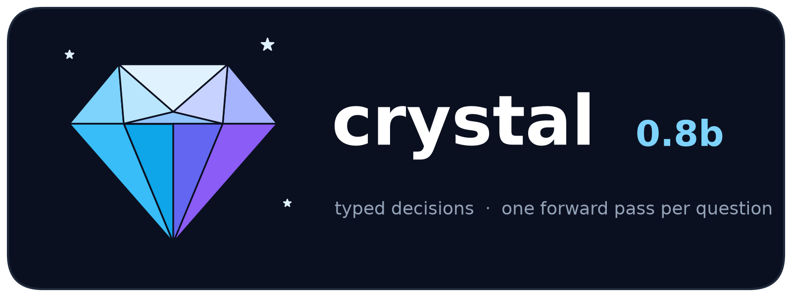
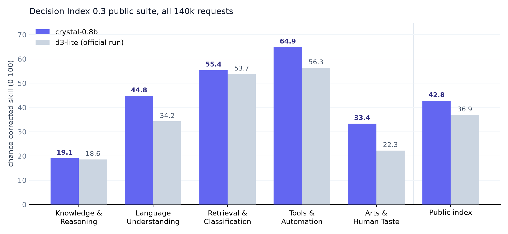

# crystal-0.8b

<div style="text-align: center">
  
  <p>
    <a href="https://huggingface.co/Qwen/Qwen3.5-0.8B">🧱 Base Model</a> |
    <a href="https://huggingface.co/spaces/multimodalart/jev-decision-index">📊 Decision Index</a> |
    <a href="https://huggingface.co/Kyunghwan-kim/crystal-0.8b/tree/main/crystal">💻 Code</a> |
    <a href="https://huggingface.co/Kyunghwan-kim/crystal-0.8b/blob/main/TRAINING_DATA.md">📄 Training Data</a>
  </p>
</div>

**crystal-0.8b** is a 0.8B decision model. Give it a state (text or JSON) and questions, either multiple choice (`choice`) or yes/no (`noul`). It returns a probability for every option. It generates no text, and each question takes one forward pass of about 30 ms.

- **Base:** [Qwen3.5-0.8B](https://huggingface.co/Qwen/Qwen3.5-0.8B), fine-tuned on gold labels from 113 public sources ([list](TRAINING_DATA.md)) and merged back with the base.
- **Inputs:** text or JSON. Questions have 2–255 options. Several questions about the same state run in one call.

## Performance

| | crystal-0.8b | d3-lite |
|:--|:--:|:--:|
| Decision Index 0.3 public suite (full, 140K requests) | **42.79** | 36.93 |
| JEVal held-out half (stand-in for the private tests) | 48.1 | **49.1** |
| fresh-v1 (held-out datasets) | **54.1** | 50.9 |

<div style="text-align: center">
  
</div>

crystal-0.8b leads on the public suite, in all five areas. On the private-test stand-in the two models are about level.

## Quickstart

```bash
pip install torch==2.10.0 --index-url https://download.pytorch.org/whl/cu128
pip install "transformers==5.17.0" safetensors huggingface_hub accelerate flash-linear-attention==0.5.2

hf download Kyunghwan-kim/crystal-0.8b --local-dir crystal-0.8b
```

```python
import sys
sys.path.insert(0, "crystal-0.8b")
from crystal import Crystal

model = Crystal.from_pretrained("crystal-0.8b")
result = model.system_one(
    state="The order arrived damaged yesterday. The customer has a receipt and asks for a replacement.",
    questions={
        "route": {"type": "choice", "instructions": "Which team should handle this?",
                  "criteria": {"returns": "Refunds and damaged deliveries", "billing": "Payments", "technical": "Product faults"}},
        "receipt": {"type": "noul", "instructions": "Does the customer have a receipt?"},
    },
)
print(result["answers"])
# {'route': {'type': 'choice', 'choice': 'returns', 'probabilities': {...}}, 'receipt': {'type': 'noul', 'noul': 0.986}}
```

Or from the command line: `cd crystal-0.8b && python -m crystal examples/request.json`.

> [!Note]
> Load the model with `crystal` (included in this repo), not as a plain causal LM. The runtime sets up the attention mode and the answer readout.
>
> The model is text only.

## License

- **Weights:** [CC BY-NC 4.0](https://creativecommons.org/licenses/by-nc/4.0/). Free for research and other non-commercial use, with attribution. Commercial use is not permitted. One training label set (the SCOTUS issue-area labels from the SCDB) is non-commercial.
- **Base model:** [Qwen3.5-0.8B](https://huggingface.co/Qwen/Qwen3.5-0.8B), Apache-2.0.
- **Runtime code:** `crystal/`, Apache-2.0. It includes code adapted from `vllm-sr/d3-lite` and `perplexity-ai/pplx-decider` (see `NOTICE`).
- **Training data:** each dataset keeps its own licence. See [TRAINING_DATA.md](TRAINING_DATA.md) for every source, its licence and how many rows were used.
- Provided as is, without warranty.
