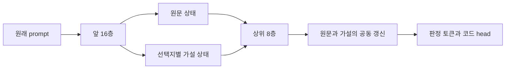

# 중간 층의 가설 작업공간

2026-10-19. 직전 delta memory는 사용자 요청으로 채택 후보에서 제외했다. 이번 설계는 선택지 정보를 Transformer 중간에 별도 상태로 넣고, 상위 층에서 원문과 가설을 함께 갱신한다. 문헌을 참고한 우리 모델용 가설이며, 최초 발명이나 정확도 개선이 입증된 방법으로 주장하지 않는다.

## 이전 실험과 달라지는 계산

기본 구조는 원래 prompt의 24개 hybrid 층과 마지막 토큰의 코드 점수를 사용한다. 이전 후보 Query 실험은 마지막 층의 후보별 Query가 같은 원문 K/V를 읽었고 원문을 갱신하지 않았다. 더 이른 readout 탐색에서는 최종 특징 위의 작은 Set Transformer도 이미 시도했다.

이번에는 앞 16개 층에서 원문을 읽고, 선택지마다 가설 벡터 하나를 만든다. 가설은 판정 토큰 상태에 선택지와 다른 선택지 평균의 차이를 결합한다. 새 1024×1024 projection은 단위 행렬로 시작하며 결합 강도 .5는 고정한다. 새 경로가 처음부터 실제 출력에 영향을 준다.

남은 8개 층에서는 다음 계산을 한다.

- full attention 두 곳(0-based 19, 23): 원문 토큰과 가설 토큰이 모두 Q/K/V가 된다. 가설끼리, 가설→원문, 원문→가설 연결이 모두 있다.
- causal DeltaNet 여섯 곳: 원문에는 원래 mixer와 MLP를 사용하고, 가설에는 같은 층의 MLP만 사용한다. 가설을 직렬 DeltaNet에 통과시켜 후보 순서를 새로 부여하지 않는다.
- 모든 가설의 RoPE 위치는 원래 판정 토큰의 위치다. 가설 슬롯만 순열하면 결과는 대응되지만, 원래 직렬 prompt 전체의 순서 불변성을 주장하지 않는다.
- 마지막 판정 토큰과 기존 코드 head가 정답을 고른다. backbone 24개와 head는 모두 학습하며 별도 모델·예측·가중치 조합은 없다.

가설이라는 이름은 인간이 읽을 수 있는 추론·반박이 들어 있음을 보증하지 않는다. 학습된 벡터에 대한 기능적 가설이다. 원문에서 가설 K/V를 읽는 연결을 차단하는 개입으로 실제 영향과 gradient를 검사한다.

## 검토한 연구와 적용 범위

| 연구 | 원문에서 확인한 근거 | 이번 설계와의 차이 |
| --- | --- | --- |
| [TRM: Less is More](https://arxiv.org/abs/2510.04871) | 작은 네트워크가 답 상태와 사고 상태를 반복 갱신하며 퍼즐 과제에서 강한 성과를 보고한다. | 퍼즐 전용 학습 결과를 자연어 Decision의 근거로 옮기지 않는다. 같은 블록 반복만 하는 기존 실패 실험과도 다르다. |
| [T²MLR](https://arxiv.org/abs/2607.15178) §4.4 | 같은 pretrained SmolLM2-1.7B를 같은 데이터로 fine-tune한 비교에서 GSM8K 35.78→39.88%, MATH500 12.80→18.00%를 보고한다. | 이전 토큰→다음 토큰의 중간 층 temporal recurrence다. 한 번에 판정하는 우리 모델에 그대로 붙이는 재현은 아니다. |
| [LLoCoT](https://arxiv.org/abs/2610.11472) | 고정 잠재 슬롯의 공동 갱신. 코드 4개 평가 평균 63.6%, answer-only SFT 62.7%, reasoning SFT 63.2%. | 원문은 VAE/flow로 만든 추론문 기반 잠재 감독과 반복을 쓴다. 이번에는 gold CE만 쓰며 층을 반복하지 않는다. |
| [INTACT](https://arxiv.org/abs/2610.19568) | frozen backbone에 학습한 latent prefix를 넣어 개선. distillation과 reinforcement 두 단계다. | 외부 encoder·추론문·RL이 포함되므로 우리 데이터·예산에서 구조만의 이득을 보증하지 않는다. |
| [Latent Recurrent Thoughts](https://arxiv.org/abs/2609.01117) | proposer와 recurrent refiner를 frozen decoder에 붙이며 task-family별로 학습한다. | 8B decoder와 별도 모듈의 비교다. 단일 범용 Decision backbone에 대한 대조가 아니다. |
| [Pause Tokens](https://arxiv.org/abs/2310.02226) | 추가 계산 토큰의 효과. 사전학습과 fine-tuning 모두에서 pause를 쓸 때 강한 성과를 보고한다. | 단순 추가 토큰의 효과와 선택지별 가설의 효과를 아직 분리하지 않았다. 이 아이디어 전체가 새롭다고 주장할 수 없다. |
| [Reasoning in Memory (RiM)](https://arxiv.org/abs/2605.30343) | 고정 memory token block을 single forward에서 계산하고, reasoning-step grounding 후 answer refinement를 학습한다. | 단일 forward 작업공간의 가까운 선행연구다. 우리는 입력 token/어휘를 추가하지 않고 16층 뒤 후보 상태를 주입하며 gold CE만 쓴다. 이 차이가 더 유리한지는 별도 가설이다. |
| [BDH-CQ](https://arxiv.org/abs/2608.09888) | 고차원 positive activation·저랭크 통신·recurrent associative memory를 사용하는 post-Transformer 계열. 150M의 ARC-AGI-1 29.5% pass@2 결과를 보고한다. | 더 근본적인 대안이지만 시각 변환 과제와 candidate construction/ranking을 포함한 시스템 결과다. 우리 자연어 가중치 재사용·동일한 학습 예산의 우월성이 입증된 것은 아니다. 이번에 BDH-CQ를 구현하거나 실험한 것으로 주장하지 않는다. |

## 사전 고정한 선별 실험

`qwen_decision.v3.hypothesis_experiment`의 `prepare`, `smoke`, `fit`으로 재현한다. 출력은 `runs/hypothesis-workspace/middle16-v1/`이다. 배포 엔진에 연결하기 전의 연구 프로토타입이며 `hypothesis_workspace.load`와 `logits`로 실제 경로를 복원한다.

- 기본 g4b와 기존의 감사된 학습 풀 12,290문항, 이미 노출된 선택셋 4,147문항/77출처를 사용한다. 전체 gold2/3/6 학습 중복·문서 연결 제외는 원래 split 감사와 입력 hash를 재사용한다.
- 이미 완료한 native 대조군과 같은 512 update, 배치16, seed41, body LR3e-6, warmup32·cosine, FP32 master AdamW다. 매 update의 prompt hash가 기존 대조군과 같아야 진행한다. projection LR1e-4, 다른 학습·증강·정답 CE는 같다. FLOPs나 실행 시간까지 같지는 않다.
- step256에서 같은 step native보다 출처 평균이 0.5%p 넘게 낮으면 중단한다. 그 외에는 512까지 진행하고 학습한 256/512 중 최선을 고른다.
- 기본의 최선 선택 점수를 최소 0.5%p 넘을 때만 새 확인셋을 준비한다. 이번 선별 스크립트는 새 확인 문항을 읽거나 평가하지 않는다.
- 이 선택셋은 반복 사용되었다. 결과가 좋아도 독립 확인 전에는 개선으로 결론내리지 않는다. seed·새 토큰만 추가한 대조·추가 학습 예산을 바꾼 비교는 아직 없다.

## 실제 선별 결과

같은 g4b 출발점에서 언어 backbone과 tied head 전체, 새 projection을 실제 512스텝 학습했다. 기존 대조군과 512개 prompt hash가 모두 일치했다. 본 학습의 trainable parameter는 753,441,600개, 이 중 새 projection은 1,048,576개다. 학습·선택 평가·저장은 총930.72초, 최대 CUDA allocated memory13.915GB였다.

| 시점 | 기본 구조의 출처 평균 | 가설 작업공간 | 차이 |
| --- | ---: | ---: | ---: |
| 추가 학습 전 | 71.4304% | 71.4846% | +0.0543%p |
| 256 update | 73.9417% | 74.1231% | +0.1815%p |
| 512 update | 75.7419% | 75.7470% | +0.0050%p |

두 arm 모두 학습한 snapshot 중 step512를 골랐다. 처음에 보였던 작은 차이가 유지되지 않았고, 선별 진입 기준 +0.5%p에 미달했다. **채택하지 않으며 새 확인셋을 열지 않았다.** 선택셋 결과만으로 정확도 개선이나 모든 workspace 설계의 실패를 주장하지 않는다.

작은 모델의 경로 영향·슬롯 순열·패딩·checkpoint gradient·요청 독립성·내보내기, CUDA hybrid mixer 검증을 포함해 관련60개 테스트가 통과했다. 실제0.8B의 별도3스텝 smoke에서도 모든 trainable gradient가 유한했고 새 projection gradient norm .02505를 확인했다. smoke 저장/재로딩의 예측·확률 차이는0이었다.

원본 입력·계획·고정 source snapshot·학습 로그·가중치·선택 예측은 `runs/hypothesis-workspace/middle16-v1/`에 보존한다. 경로 개입·최종 저장 복원·비용 검증은 [결과 JSON](hypothesis-workspace-results.json)에 기록한다. 프로토타입은 `hypothesis_workspace.load`와 `logits`로 복원하며 기본 엔진에는 연결하지 않았다.

### 경로 검사에서 확인한 한계

최종 모델의 전체4,147문항 재로딩은 예측·확률 차이0이었다. 같은 학습 가중치에서 workspace를 제거한 수동 native 계산도 일반 native forward와 logits 차이0이었다. 원본24개 층이 모두1회 실행되고, 상위 full-attention 두 곳에만 K행이 추가되는 것도 확인했다.

출처별로 고정 hash로 뽑은512문항에서, 가설→원문 연결을 끊으면 예측1개·확률 최대.02873이 달라졌다. 선택지 성분을 제거하고 판정 토큰의 복사만 가설에 넣으면 예측은 그대로이고 확률 최대.01763이 달라졌다. 이 표본에서는 가설 내용이 최종 선택에 미친 영향이 작았다. projection은 단위 행렬 대비 상대 Frobenius norm4.10%만큼 학습되었으므로 단순 미학습이나 0 초기화 때문이라고 단정하지 않는다.

슬롯 순서를 뒤집은512문항도 예측 불일치0이었다. BF16 최대 확률 차이는.00553으로 bitwise 불변은 아니다. 연결 차단과 native 계산 사이에도 BF16 attention 형태 차이로 최대 확률 차이.00454가 있었다. 이 수치 오차와 실제 경로 개입을 구분한다.

같은 가중치·준비된 GPU 입력512개/145배치를 세 번 번갈아 측정한 중앙값은 native8.8199초, workspace9.0814초로2.96% 늘었다. Python/mask/slot 계산을 포함하지만 tokenization·loading은 제외했고 서비스 지연 측정은 아니다. 선택셋에서는 기본 대비 오답12개 회복·정답14개 악화, micro76.7302%→76.6819%였다. 추가 계산과 정확도 양쪽의 우위를 얻지 못했다.

## 두 번째 선별: 판정 출구를 가설로 제한

위 개입 결과를 보고 원문 판정 벡터의 직접 readout을 제거한 별도 구조를 준비했다. 후보 i의 최종 workspace 벡터를 normalize한 뒤 원래 code i의 output embedding과 내적한다. `s_i = norm(slot_i) · W_code_i`이며, 원문 판정 토큰을 직접 score하는 경로는 없다. 원문은 가설의 K/V 근거로 계속 쓰이고 가설→원문→가설의 상호작용도 유지된다.

이 버전은 [workspace_bottleneck.py](../../qwen_decision/v3/workspace_bottleneck.py), [bottleneck_experiment.py](../../qwen_decision/v3/bottleneck_experiment.py)로 분리했다. 기존 workspace 실험의 소스나 고정 manifest는 바꾸지 않았다. 출력 위치만 바꾸는 사후 추론 선택으로 비교하지 않고, 같은 초기 g4b에서 새로 학습한다. 별도 모델 조합은 없다.

같은512 update 상한·body LR·새 projection LR·배치·seed·정답 CE·입력 순열을 사용한다. step256에서 같은 step native보다0.5%p 넘게 낮으면 중단하고, 최선 선택 점수가 native 최선보다0.5%p 이상 높을 때만 별도 확인을 준비한다. 반복 사용한 선택셋의 한계는 동일하다.

원문 출구가 없는지에 대한 gradient 검사, backbone/checkpoint gradient, 올바른 readout을 내보내고 잘못된 loader를 거부하는 검사3개를 추가해 관련63개 테스트를 통과했다. 실제0.8B의3스텝 smoke에서도 유한한 전체 gradient·같은 prompt hash·재로딩 예측/확률 차이0을 확인했다. 첫 배치의 projection gradient norm은1.1415로 앞 버전 .02505보다 약45.6배 크다. gradient 크기 자체를 정확도 개선의 근거로 쓰지는 않는다. 실행 경로는 `runs/hypothesis-workspace/bottleneck16-v1/`이다.

실제 선별 결과는 다음과 같다.

| 시점 | 같은 시점 기본 | 가설 출구 강제 | 차이 |
| --- | ---: | ---: | ---: |
| 추가 학습 전 | 71.4304% | 69.1702% | −2.2602%p |
| 256 update | 73.9417% | 73.1286% | −0.8131%p |

사전 중단 기준(같은256 update native보다0.5%p 초과 열세)에 해당해256스텝에서 중단했다. 모든256개 prompt hash가 기본 대조군의 앞256개와 일치했고, 전체 backbone·head 학습은 동일했다. 실행 총501.74초, 최대 CUDA allocation13.916GB였다. 이 버전을512스텝까지 실행한 것으로 쓰지 않는다. 결과 JSON의 최선 native512 대비 차이−2.6133%p는 **업데이트 수가 다른 비교**이며, 같은 예산의 주 비교는 위의−0.8131%p다.

이 선별 규칙에서 채택하지 않았고 새 확인셋은 사용하지 않았다. 초기보다 학습한 점수가 오른 것은 구조 이득이 아니다. 초기 격차가 학습 중 줄었으므로 더 긴 학습으로 어떻게 될지도 이번 조기 중단만으로 판단하지 않는다. 현재0.8B checkpoint의 짧은 retrofit 결과를 전체 workspace 계열이나 사전학습부터의 구조 비교로 일반화하지 않는다. [별도 결과·복원·경로 검사](workspace-bottleneck-results.json)에 수치를 보존한다.

최종256스텝 모델의 전체4,147문항 저장 복원은 예측·확률 차이0이었다. 같은256스텝 기본 대비 오답124개 회복·정답149개 악화였다. 학습 입력256개 hash도 독립 검사에서 모두 일치했다.

같은512문항 경로 검사에서 선택지 성분을 제거하면 **예측33개**, 최대 확률.29142가 달라졌다. 앞 버전의0개와 달리 후보 내용이 실제 선택에 영향을 미쳤다. 반면 가설→원문 연결만 차단하면 예측은 같고 최대 확률.01711만 달라졌다. 가설 출구가 있다고 해서 원문 재작성 경로까지 유용하게 학습된 것으로 단정하지 않는다. 선택지 성분을 지운 경우의 표본 출처 평균72.4598%, 활성 상태72.2635%는 사후 진단이며 이를 새 후보 선택이나 개선 주장에 사용하지 않았다.

projection의 단위 행렬 대비 상대 Frobenius 변화는3.582%였다. 가설 슬롯 순서만 뒤집은512문항은 예측 차이0, BF16 최대 확률 차이.00983이었다. 준비된 GPU 입력을 같은 가중치에서 세 번 번갈아 측정한 중앙값은 native8.8357초→가설 출구9.0738초(+2.70%)였다. tokenization·loading을 제외한 비용이며 실제 서비스 호출 지연의 수치가 아니다. 선택지 정보를 쓰는 구조 변경과 실행 경로는 확인했지만 정확도·비용 이득은 확보하지 못했다.
