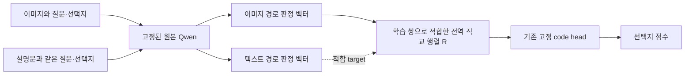

# 원본 Qwen의 이미지·텍스트 판정 표현을 회전으로 연결하기

[위키 홈](../README.md) · [논문 정밀 분석](../papers/platonic-jepa.md) · [실험 코드](../../qwen_decision/v3/rotation_pilot.py) · [원 실험 수치](rotation-alignment-results.json) · [사후 감사 수치](rotation-alignment-audit.json)

2026-11-04, 사용자 요청으로 plain Qwen3.5-0.8B에 작은 회전 정렬 실험을 적용했다.
**모델을 고정하고 회전만 맞추자, 별도 합성 장면 192개에서 정답률이 76.56%에서
81.77%로 올랐다. 정답률 차이의 구간은 0을 포함하고, 정답 NLL 감소 구간은 0을 포함하지 않는다.**
실제 사진이나 새 도메인으로의 전이를 입증한 결과는 아니다.

**11-04 정밀 감사 후 해석:** 고정 VLM의 최종 판정 표현을 직교 사상으로 보정한 실험이다.
독립적인 이미지·텍스트 인코더의 동치나 JEPA 정리의 재현이 아니다.
회전은 내부 이웃 구조를 바꾸지 않고, 고정 출력층에 대한 방향을 바꾼다.
평균 방향만 맞춰도 cosine이 .961까지 높아져, .979라는 수치만으로 의미 일치를 주장할 수 없다.
아래 원 실험 수치는 보존했고, 사후 분석은 별도 절과 JSON으로 구분했다.

## 목표 적합성 재검토: 이 실험이 잘못된 것인가

**2026-11-04 사용자 재질문 후 판단:** 수치 계산과 명시한 readout 보정 실험은 유지한다.
다만 이 pilot만으로 사용자가 관심을 둔 **인코딩된 상태의 모달리티 간 연결과 텍스트 판단의 재사용**을
평가한 것으로 제시하는 것은 부적절하다. 처음부터 검증 질문을 더 좁고 명확하게 설명했어야 한다.

| 확인할 질문 | 이번 설계가 답하는 정도 |
|---|---|
| 같은 질문 형식에서 마지막 이미지 판정 벡터를 텍스트 판정 벡터 쪽으로 맞추면 점수가 달라지는가 | 직접 측정했다. NLL 개선과 불확실한 정확도 상승을 관측 |
| 질문·선택지와 독립적인 이미지/텍스트 상태 표현이 회전으로 대응되는가 | 측정하지 않았다. 추출할 때 이미 질문·선택지를 모두 읽음 |
| 한 번 연결한 상태 표현을 다른 질문·선택지에 재사용할 수 있는가 | 측정하지 않았다. 새로운 장면만 분리했고 질문 형식과 코드 체계는 공유 |
| 좋은 view로 별도 학습한 인코더가 회전 동치가 되는가 | 인코더·JEPA 학습을 하지 않았으므로 검증하지 않음 |

**판정 위치 선정이 핵심 한계다.** 추출한 벡터는 시각 인코더 출력이나 질문 이전의 상태가 아니라,
장면·질문·선택지·코드가 모두 섞인 공통 VLM의 마지막 벡터다. 텍스트 target도 이미 같은 판단 문제를 푼 표현이다.
따라서 결과는 특정 과제 형식에서의 cross-modal readout 적응과 상태 표현의 일반적인 연결을 구별하지 못한다.

반대로, 아래 두 사실은 실험 실패의 근거로 사용하면 안 된다.

- **출력 head를 회전하는 것과 동치:** 모든 직교 사상 뒤에 선형 classifier를 붙이면 생기는 항등식이다.
  올바른 상태 표현 정렬 실험에서도 성립할 수 있다. 이 동치 자체가 정렬 적용을 무효화하지 않는다.
- **mutual kNN·CKA가 회전 뒤 그대로임:** 직교 변환의 정상적인 성질이다.
  변화가 없다는 이유로 회전 정렬이 실패했다고 결론 내릴 수 없다.
  논문은 이 지표로 서로 다르게 학습한 인코더의 기하를 비교하고, 실제 공간 연결은 회전 후 검색 등으로 평가한다.

평균 방향만으로 높은 cosine을 얻은 대조는 **높은 cosine만으로 결론 내리는 방식**을 반박한다.
실제 대응 사상에 아무 효과가 없다는 결론까지 지지하지는 않는다. 실제 대응의 중심화 cosine과 NLL 차이는 별도로 남는다.

질문에 더 직접 답하려면 두 단계를 분리해야 한다. 우선 질문·선택지를 넣기 전의 상태 표현에서
중심화·차원을 train만으로 정하고, 별도 장면에서 실제 대응·평균 보정·여러 shuffle 대비 회전 후 검색을 비교한다.
그다음 **텍스트 상태 표현만으로 학습한 질문 조건부 Decision 모듈을 고정**하고,
회전된 이미지 상태 표현으로도 미학습 질문·선택지에서 작동하는지 검사한다.
상태 벡터를 기존 Qwen의 마지막 code head에 곧바로 넣는 것은 별도 정당화가 필요하다.
독립 인코더와 good-view JEPA의 이론적 설정을 재현하려면 그 학습 실험도 따로 필요하다.
이후 같은 날 [질문 이전 상태의 회전·텍스트 판정 전이 실험](state-rotation-v2.md)을 실행했다.
질문 없는 상태 검색과 seen 질문의 일부 전이는 관찰했지만, 미학습 질문에서는 텍스트 모듈 자체의 기준선이 낮았다.
독립 JEPA 인코더 학습이나 자연 이미지 전이까지 실시한 것은 아니다. 이 문서의 원 pilot 수치는 그대로 보존한다.

## 적용 위치와 조건

- 모델: `Qwen/Qwen3.5-0.8B`, revision `2fc06364715b967f1860aea9cf38778875588b17`.
  로컬에서 정리됐던 원본 가중치 1.75GB만 해당 revision으로 복구했다.
  여기서 plain은 우리 Decision 미세조정을 하지 않았다는 뜻이다. 사전학습이 없는 모델이나
  이미지·텍스트 학습 이력이 없는 unimodal 모델이라는 뜻은 아니다.
- 기존 causal attention과 비전 경로를 사용한다. 양방향 전환, LoRA, 모델 미세조정은 없다.
  모델 파라미터 852,985,920개가 모두 고정됐고, 생성 호출도 없다.
- 같은 장면의 이미지와 프로그램으로 작성한 사실 서술에 동일한 질문·선택지·답 코드를 붙인다.
  d3 입력 형식, 마지막 입력 토큰의 1,024차원 hidden state, 기존 tied LM head를 사용한다.
  이미지 token이나 비전 타워의 출력 자체를 회전한 것이 아니다.
- 이미지 판정 벡터를 `h_I`, 텍스트 판정 벡터를 `h_T`라 하면,
  학습 장면에서 `normalize(h_I) @ R ≈ normalize(h_T)`가 되는 직교 행렬 하나를 구한다.
  추론은 `h_I @ R`에 기존 코드 head를 적용한다. 회전 전후 벡터 길이는 유지된다.
- 두 인코더를 따로 학습한 JEPA 실험이 아니라, 하나의 고정된 VLM에서 모달리티별
  판정 표현의 차이를 후처리로 줄일 수 있는지 보는 실험이다.

## 데이터·선택·대조군

- 256×256 흰 배경에 색 6종·도형 4종 중 서로 다른 두 물체를 그렸다.
  색·도형·상대 위치를 묻고, 정답과 설명문은 장면 명세에서 프로그램으로 만든다.
  교사 모델, 생성 모델의 캡션·라벨은 없다.
- 학습 384, validation 96, test 192장이다. 각 split의 세 과제 수는 같다.
  물체 순서를 뒤집어 같은 세계를 재서술하는 경우까지 제외한 서로 다른 장면으로 분리한다.
  과제별 개수가 같다는 뜻이며, 정답 클래스까지 균등한 것은 아니다.
  예를 들어 test 색 문항에서 orange는18개, green은4개다.
- 384쌍으로는 1,024차원 전체 회전을 고유하게 결정할 수 없다. 따라서 identity 쪽으로
  당기는 벌점을 더해 관측되지 않은 방향을 보수적으로 처리한다.
  목적함수는 `||X R-Y||² + n*ratio*||R-I||²`, 제약은 `R.T R=I`다.
- `ratio ∈ {0.001, 0.01, 0.1, 1}` 중 validation의 정규화 벡터 오차가 최소인
  0.001을 선택했다. 정답 라벨과 test 특징은 행렬 적합·선택에 사용하지 않는다.
- 음성 대조군은 학습 쌍의 텍스트를 **질문·선택지가 같은 그룹 안에서** 섞는다.
  384쌍 모두 실제 장면 대응이 바뀌었다. 동일한 벌점 강도로 다른 회전을 구한다.
- 실행 전에 `runs/rotation-pilot/plain-qwen-v1/plan.json`에 설정과 코드 해시를 기록했다.
  원시 특징, 실제 행렬, 장면 명세, 문항별 점수는 같은 폴더에 보존했다.

## 최종 test 결과

192장, 각 과제 64장이다. NLL은 낮을수록 좋다.

| 경로 | 정답 / 192 | 정답률 | 정답 NLL | 텍스트 벡터와 평균 cosine |
|---|---:|---:|---:|---:|
| 원본 이미지 입력 | 147 | 76.56% | 0.6447 | 0.8372 |
| 이미지 + 실제 대응으로 구한 회전 | 157 | 81.77% | 0.5522 | 0.9786 |
| 이미지 + 대응을 섞어 구한 회전 | 153 | 79.69% | 0.6400 | 0.9712 |
| 같은 사실을 텍스트로 입력 | 169 | 88.02% | 0.5275 | 1 |

| 이미지 과제 | 원본 | 실제 대응 회전 |
|---|---:|---:|
| 색 | 96.88% | 96.88% |
| 도형 | 73.44% | 84.38% |
| 상대 위치 | 59.38% | 64.06% |

test 장면을 짝지어 5,000회 bootstrap했다.

- 회전 − 원본 정답률: **+5.21%p**, 95% 구간 **[−1.04, +11.46]%p**.
- 회전 − 원본 NLL: **−0.0925**, 95% 구간 **[−0.1701, −0.0221]**.
- 실제 대응 회전 − 섞은 대응 회전 정답률: +2.08%p, 구간 [−2.60, +6.77]%p.
- 실제 대응 회전 − 섞은 대응 회전 NLL: −0.0878, 구간 [−0.1333, −0.0430].

정규화 벡터 오차는 0.3256에서 0.0428로 줄었다. 하지만 대응을 섞어도 cosine이
0.9712까지 올라간다. 이것만으로 공통 프롬프트와 평균 차이가 원인이라고 확정하지는 못했다.
아래 평균 방향 대조와 중심화 분석으로 가능한 설명을 추가로 검사했다.
과제별로 색·상대 위치 NLL은 조금 나빠지고 도형 NLL이 크게 좋아졌다.

## 해석과 검증 범위

- 모델 전체를 바꾸지 않고 **회전 하나로 판정 공간을 보정할 가능성**은 관찰했다.
- 정확도 개선은 아직 확정하지 않는다. NLL 개선도 같은 합성 분포의 샘플 구간이며,
  모델 seed나 자연 이미지·새 질문 형식의 불확실성을 포함하지 않는다.
- 논문의 이상적 동치 정리나 독립 JEPA 인코더의 정렬을 재현한 것이 아니다.
  다음 확인에는 별도 자연 이미지·충분한 사실 서술 쌍과 새로운 평가 문항이 필요하다.
- 행렬의 최대 직교성 오차는 약 `1.01e-6`, 벡터 길이 오차는 `3.05e-5`다.
  알려진 회전 복구·미관측 공간 보존·장면 분리와 음성 대조군 검사 3개가 통과했다.
  GPU 특징 추출은 약 20.6초였다(가중치 다운로드·로딩·행렬 적합 제외).

## 1. 실제 계산한 회전과 학습된 부분

행벡터를 사용한다. 학습 이미지 표현을 L2 정규화한 행렬을 `X`, 텍스트 표현을 정규화한 행렬을 `Y`라 하자.

$$
\min_{R^TR=I}\|XR-Y\|_F^2+\lambda\|R-I\|_F^2,
\qquad\lambda=n\cdot\mathrm{ratio}.
$$

직교 제약에서 목적함수의 가변 부분은 `−2 tr(R^T(X^T Y+λI))`다.
`X^T Y+λI=UΣV^T`를 SVD하면 `R=UV^T`로 구한다.
적합 시 각 벡터를 정규화하고, 추론에서는 **정규화 전 원래 판정 벡터에 같은 R**을 적용한다.
원래 벡터 길이를 바꾸지 않으므로 원래 head의 logit scale도 벡터 정규화 자체로 바꾸지는 않는다.
맞춘 목적은 unit vector의 방향 차이이며, 정규화 전 이미지·텍스트 벡터의 길이까지
같게 만드는 목표는 아니다. 높은 cosine은 원 벡터의 정확한 등식과도 구분해야 한다.

`R`은1,024×1,024 행렬이다. 직교군 자체의 자유도는 `1024×1023/2=523,776`이다.
384쌍이 고차원 전체의 진짜 회전을 유일하게 식별하는 것은 아니며, identity 벌점이 부족한 방향을 규정한다.
이 벌점도 입력이 임의로 복잡한 경우 모든 수치적 유일성을 보장하는 일반 정리는 아니다.
이번 수치는 보수적으로 규제한 적합 결과다. 모델 파라미터 업데이트가0이라는 것과 **사상 학습이 없다**는 것은 다르다.

정답 one-hot은 사상 적합·강도 선택에 넣지 않았다. 그러나 텍스트 target은 장면 사실과 질문을 담고 있으며,
384개의 이미지·텍스트 **대응 정보** 자체가 감독 신호다. 완전 무감독·pair-free로 부르면 안 된다.

## 2. 고정 출력층을 바꾸는 것과 정확히 동치다

저장한 후보 head를 행렬 `W`라고 하면,

$$
\mathrm{logits}=h_I R W^T=h_I(W R^T)^T.
$$

즉 효과적인 출력 head를 `W'=W R^T`로 바꾸는 것과 같다.
이 행렬 항등식은 저장된 test 표현에서 최대 logit 차이 `1.78e-14`로 검산했다.
이는 새로운 학습 결과가 아니라 적용 위치를 정확히 설명하는 대수적 동치다.
일반적인 정렬 표현 뒤의 선형 판정에서도 성립하므로, 이 사실만으로 이번 적용을 무효라고 판정하지 않는다.

모델 안의 원래 이미지 처리·attention·중간 표현은 그대로다.
판정 벡터에 이미 있는 정보의 readout을 바꾸는 효과는 가능하지만, 이미지에서 사라진 정보를 새로 만들지는 않는다.
대응 텍스트 표현도88.02%이므로 정답 oracle이 아니다.
회전과 head를 서로 상쇄되게 함께 바꾸면 원래 판단이 유지되지만, 여기서는 **head를 고정**해 판단이 바뀐다.



## 3. 사후 감사: 같은 결과를 다른 계산으로 확인

감사 코드: [rotation_audit.py](../../qwen_decision/v3/rotation_audit.py).
원 실험의 함수로 같은 평균을 다시 출력하는 수준에 그치지 않고,
저장된 문항별 logits에서 NumPy float64 softmax·로그를 별도로 계산했다.

- 672개의 ID·세계 명세·렌더링한 이미지 바이트가 각각 모두 달랐다.
- 질문에서 지칭한 색·도형과 세계 명세로 gold를 별도로 도출해672문항 전부 일치했다.
- 192개 test의 모든 비교군에서 정답 수와 NLL이 원 기록과 허용오차 `2e-6` 안에서 일치했다.
- 원 실험 코드·계획·명세·특징·사상·예측·원본 가중치의 저장 SHA256을 모두 확인했다.
- 모델 fit과 별도로, test의8개 장면×두 모달리티를 단일 행으로 재실행한 표본 검사는
  [forward-spotcheck.json](../../runs/rotation-pilot/plain-qwen-v1/forward-spotcheck.json)에 보존한다.
  16/16개에서 원래 예측이 같았고 hidden cosine 최솟값은 .9990이었다.
  BF16의 logit 차이는 최대 .2980으로0은 아니므로, 전체 배치 독립성이나 전 문항 일치를 증명하는 검사는 아니다.

원본과 회전의 정답 변화는 **오답→정답24개, 정답→오답14개**다.
순증10개를 모든 기존 오답 중10개만 고친 것으로 읽으면 안 된다.
사후 exact McNemar 양측 p값은 .1433이며 정확도 개선을 확정하기 어렵다는 해석과 일치한다.

원 기록은192장 전체에서5,000회 paired bootstrap했다.
사후 감사에서는 세 과제의64장씩을 유지하며20,000회 층화 bootstrap했다.
원본 대비 정확도 차이 구간은 [−1.04,+11.46]%p,
NLL 차이 구간은 [−0.1623,−0.0266]으로 원 해석을 뒤집지 않았다.
새 사상을 재적합하지 않으므로 **적합된 R과 데이터 분할에 조건부인 표본 불확실성**이다.

정답률·NLL 두 지표를 보고, 추가 대조·세부 과제도 읽었다. 원 계획은 비교와 선택 규칙을 고정한 기록이지,
가설 검정의 모든 유의수준·다중비교 보정까지 외부 사전 등록한 문서는 아니다.
각 구간은 보정하지 않은 개별95% 구간으로 해석한다.

## 4. 사후 평균 방향 대조: 높은 cosine의 의미

이 절의 대조군과 지표는 **원 test 결과를 본 뒤 추가한 탐색 분석**이다.
기존192장을 다시 읽는 것이므로 새로운 미관측 확인 실험으로 세지 않는다.

학습 이미지 표현의 평균 방향을 텍스트 표현의 평균 방향으로 보내는2차원 평면 회전만 만들었다.
나머지 방향은 identity로 두고, 개별 이미지·텍스트 대응은 사용하지 않았다.
두 평균은 쌍을 섞어도 같으므로 **비대응 평균 통계만으로 구할 수 있는 대조군**이다.
이는 모든 가능한 평균 보정 방법을 대표하거나 그 중 최선을 고른 대조는 아니다.

| 사상 | 대응 cosine | train 평균 제거 후 cosine¹ | 정답률 | NLL |
|---|---:|---:|---:|---:|
| 없음 | .8372 | .6032 | 76.56% | .6447 |
| 평균 방향만 맞춤 | .9613 | .6031 | 76.56% | .6859 |
| 질문 내 장면 대응을 섞은 사상 | .9712 | .7391 | 79.69% | .6400 |
| 실제 대응을 사용한 사상 | .9786 | .8128 | 81.77% | .5522 |

¹ 각 표본을 먼저 unit vector로 만들고, 각 모달리티의 train unit-vector 평균을 빼서 비교한다.
단순히 원래 cosine을 보정한 수가 아니라 다른 진단 지표다. 평균 제거는 train에서만 적합했다.

test의 unit-vector 평균이 차지하는 제곱 길이는 이미지 .8801, 텍스트 .9348이다.
단위벡터의 총 평균 제곱 길이가1이므로 각각88.0%,93.5%에 해당하는 큰 공통 방향 성분이 있다.
**이 비율을 nuisance 비율·시각 정보량·설명 분산율로 부르지 않는다.**
그 성분이 프롬프트·모달리티·언어 구조 중 무엇 때문인지는 이 분해만으로 특정하지 못한다.

평균만 맞춰도 cosine은 크게 오르지만 NLL은 나빠졌다.
따라서 높은 cosine을 높은 판단 능력으로 해석할 수 없다.
실제 대응은 평균 대조보다 중심화 cosine과 NLL이 좋으므로,
현재 증거는 **평균 방향 이외의 대응 정보도 쓰였을 가능성**을 지지한다.
정확한 세계 표현 동치나 의미 전반의 공유를 입증하지는 않는다.

## 5. 논문 지표로 보면 회전 전후에 바뀌지 않는 것

정방 직교변환은 `(XR)(XR)^T=XX^T`이므로 내부 거리를 보존한다.
저장된 test 특징에서 아래도 확인했다.

| 진단 | 원본 | 실제 대응 회전 | 평균 방향 회전 |
|---|---:|---:|---:|
| mutual 10-NN, clipping 없음 | .5266 | .5266 | .5266 |
| 중심화 linear CKA, biased 추정 | .8370 | .8370 | .8370 |

모든 비교군에서 이 값들은 그대로였고, 원본과 실제 회전의 unit-vector Gram 최대 차이는 `3.49e-9`다.
우리 CKA는 biased 중심화 버전이고 논문은 unbiased HSIC이며,
층 탐색·95% clipping도 하지 않았다. **논문의 표와 직접 순위를 비교할 수 없다.**

논문의 핵심은 view 학습이 내부 기하를 바꾸고, 그 결과 서로 다른 인코더의 기하가 가까워진다는 데 있다.
이번에는 인코더를 학습하지 않아 내부 기하는 처음부터 고정돼 있다.
회전 후 직접 cosine이 오른 것과 PRH의 내부 기하 정렬이 좋아진 것을 혼동하지 않는다.

정규화 오차 .3256→.0428과 cosine .8372→.9786도 독립적인 두 증거는 아니다.
단위벡터에서는 `||a-b||²=2−2cos(a,b)`이므로 같은 사실의 두 표현이다.

## 6. 대응을 섞은 대조군의 해석과 제약

대조군은 무작위 이미지와 전혀 다른 질문을 연결하지 않았다.
**같은 질문·동일한 선택지 문구 안에서** 텍스트 장면을 섞었다.
따라서 질문·선택지 정보는 유지되고 장면 대응만 바뀐다.
384쌍 모두 다른 장면이 됐지만, 우연히 gold가 같은 비율은24.48%였다.
같은 정답을 갖는 잘못된 대응까지 모두 다른 정답으로 바꾼 대조군은 아니다.

실제 대응 사상은 이 대조군보다 NLL이 .0878 낮았지만,
정확도는 순증4문항에 그쳤다(오답→정답12, 정답→오답8).
그 정확도 차이의 구간도0을 포함한다.

대조군은 한 번의 shuffle만 사용했다. 여러 shuffle의 귀무분포를 만든 permutation test가 아니다.
또한 가중치 강도는 실제 대응 validation에서 고른 값을 그대로 썼다.
대조군을 별도 validation으로 똑같이 최적화한 조건과는 다르다.
NLL 차이를 실제 장면 대응이 유용했다는 초기 근거로 읽되,
쌍 학습의 일반적인 인과효과나 모든 무대응 방법에 대한 우위로 확장하지 않는다.

사후 검색에서도 동일 질문 내에서 대응 텍스트를1등으로 찾는 비율은
원본32.81%, 평균 방향38.02%, 섞은 대응35.42%, 실제 대응40.10%였다.
동일 질문 그룹은22개, 그룹 안 균등 선택의 전체 기대값은11.46%다.
이 검색은 질문 문구만 맞춰 생기는 효과를 일부 줄이지만,192개 합성 장면의 사후 진단이라는 한계는 같다.

## 7. 논문과 우리 실험을 직접 대응시키기

| 항목 | 논문의 정리·중심 실험 | 우리 pilot |
|---|---|---|
| 인코더 | 모달리티별 별도 학습 | 이미 공동 학습된 Qwen의 같은 백본 |
| JEPA 학습 | good/bad-view 목적함수 비교 | 없음 |
| 표현 위치 | unimodal embedding, 여러 층 평가 포함 | 질문·선택지를 모두 읽은 마지막 판정 벡터 |
| 중심화·whitening | 정리는 whitening, 실용 사상은 평균 보정 포함 | 사상 적합은 비중심화 unit vector, whitening 없음 |
| 행렬 | 이론은 동일 차원 직교, 실험 일부는 직사각형 | 1,024차원 정방 직교, identity 벌점 |
| 대응 데이터 | 학습 view그룹과 별도 사상·일부 pair-free 추정 |384개의 이미지·사실 서술 대응 |
| 주 평가 | 내부 기하·caption 검색·captioning | 합성 Decision 정확도·NLL |
| 변한 것 | view 학습으로 인코더 자체가 달라짐 | 출력 head에 대한 방향만 달라짐 |

따라서 정확한 실험명은 **‘고정 plain Qwen의 판정 표현에 대한 대응 기반 직교 readout 보정’**이다.
‘독립 시각·언어 인코더의 세계 표현 동치 증명’, ‘JEPA 학습 재현’, ‘회전만으로 시각 지식을 획득’은 아니다.

## 8. 유지할 결론과 다음 검증 조건

**현재 지지되는 결론:** 이 고정 모델·합성 분포에서, 실제 대응으로 맞춘 직교 readout 보정은
원본보다 평균 정답 NLL이 낮았고, 정확도도 관측상10문항 높았다.
표본 불확실성과 과제별 손익을 함께 고려하면 정확도 개선·새 도메인 전이를 확정할 수 없다.

다음 실험이 해결해야 할 질문은 서로 다르다. 아래는 **미실시 제안**이다.

| 확인할 주장 | 필요한 조건 |
|---|---|
| 같은 분포에서 반복되는가 | 새 장면 seed·새 적합/validation/test 분할로 사전 고정한 확인 |
| 실제 대응의 효과인가 | 여러 질문 내 shuffle, 대조군도 같은 validation 예산으로 선택 |
| 간단한 보정 이상의 효과인가 | 평균 이동·평균 방향·기존 출력 보정과 같은 데이터/선택 예산 비교 |
| 자연 이미지로 옮겨 가는가 | 중복 없는 사진·충분한 사실 서술, 맞춘 출처와 다른 평가 출처 |
| code/위치 특수성인가 | 보기 순서·답 코드 변경, 새 질문 template·새 후보 수 |
| 논문처럼 독립 인코더를 연결할 수 있는가 | 실제 독립 인코더에서 정의한 동등 정보의 표현, 별도 사상 및 held-out 판단 |
| 학습 기하 자체가 좋아지는가 | good-view 인코더 학습과 동일 데이터·계산량 대조, 회전 불변 지표 평가 |

이미 본192문항으로 위 제안들을 골라 다시 최선값을 보고하면 확인 실험이 아니다.
평균 cosine, 평균 NLL, 정답률을 각각 목적에 맞게 평가하고 원 결과와 사후 진단을 계속 분리한다.

## 재현과 증거 파일

```bash
.venv/bin/python -m unittest tests.test_v3_rotation_pilot
.venv/bin/python -m unittest tests.test_v3_rotation_audit
.venv/bin/python -m qwen_decision.v3.rotation_pilot --out runs/rotation-pilot/plain-qwen-v1-recheck
.venv/bin/python -m qwen_decision.v3.rotation_audit
```

모델 가중치를 먼저 해당 revision으로 복구해야 한다. 기존 결과 폴더는 덮어쓰지 않는다.
저장된 특징만 다시 분석하려면 `--analyze-only --out runs/rotation-pilot/plain-qwen-v1`을 사용한다.
이 옵션은 원 run의 보고서·사상을 다시 쓰므로 원 증거 보존이 필요하면 먼저 다른 폴더에 복사한다.
사후 감사 명령은 원 run을 읽기만 하고 별도의 감사 JSON을 만든다.

| 파일 | 역할 |
|---|---|
| [rotation-alignment-results.json](rotation-alignment-results.json) | 원 실험 보고서의 보존 사본 |
| [rotation-alignment-audit.json](rotation-alignment-audit.json) | 독립 수치 검산·탐색 진단·범위 제한 |
| `runs/rotation-pilot/plain-qwen-v1/plan.json` | 추출 전에 저장한 계획·원 코드 해시 |
| 같은 폴더 `scenes.jsonl`, `features.pt`, `rotation.pt`, `predictions.jsonl` | 전체 명세·벡터·실제 행렬·문항별 점수 |
| 같은 폴더 `checksums.json`, `forward-spotcheck.json` | 원 증거 SHA256·단일 행 forward 표본 확인 |

원 run은gitignore 대상이어서 현재 작업 폴더에 보존된다. 작은 두 결과 JSON과 감사 코드는git으로 추적 가능한 파일이다.

근거: [Balestriero & LeCun, Proving and Improving the Platonic Representation Hypothesis with JEPAs](https://arxiv.org/abs/2610.39302v1).
