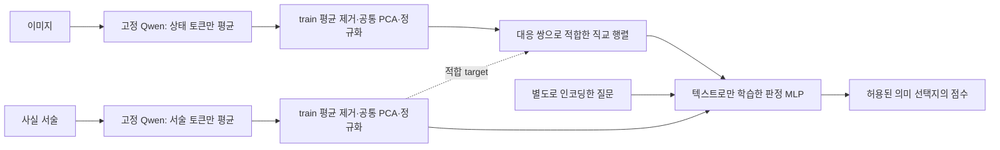

# 질문 이전의 상태를 회전하고 텍스트 판정을 이미지로 옮기기

[위키 홈](../README.md) · [논문 분석](../papers/platonic-jepa.md) · [이전 판정 벡터 실험](rotation-alignment.md) · [코드](../../qwen_decision/v3/state_rotation.py) · [결과](state-rotation-v2-results.json) · [독립 검산](state-rotation-v2-verification.json)

**2026-11-04 완료.** 원본 Qwen3.5-0.8B를 고정하고, 질문·선택지가 없는 상태 표현을 먼저 추출했다.
이미지·텍스트 상태를 연결하는 회전을 적합한 뒤, 텍스트 상태만으로 학습한 별도 판정 모듈을 이미지에 적용했다.

**같은 질문 유형을 새 이미지에 적용하는 전이는 일부 관찰했다.** 이미지의 평균 방향만 보정한 경우
정답률25.97%, 회전까지 적용한 경우43.47%였다. 텍스트 기준선은83.97%여서 격차가 크다.
학습에서 제외한 질문 조합은 텍스트 기준선 자체가29.96%로 낮았으므로,
그 질문들에 대한 일반화 성공·실패를 회전 탓으로 판단할 수 없다.

이전 실험의76.56%→81.77%와는 장면·질문·판정 모듈이 다르다. 두 수치의 크기를 직접 비교하지 않는다.
이번43.47%는 원래 Qwen의 native LM head 정확도가 아니라 **텍스트로 학습한 작은 모듈의 이미지 전이 점수**다.

**동일 데이터 후속:** [Crystal 학습 방식 비교](crystal-state-methods.md)에서 같은 분할·문항으로
causal FT와 Crystal FT를3seed씩 실행했다. 수치 연산을 맞춘 원본 재측정은43.28%였다.
정상 양방향 추론끼리 비교하면 Crystal의 검색은 개선됐지만 회전 판정 전이의 추가 개선은 확인되지 않았다.
이 페이지의 원 실험 수치는 보존한다.

## 1. 수정한 검증 대상

이전에는 질문·선택지를 읽은 마지막 판정 벡터를 맞췄다. 이번에는 다음을 분리했다.

1. `E_I(image)`와 `E_T(caption)`은 질문·선택지 없이 한 번 계산한다.
2. 이미지·텍스트 상태의 대응만으로 전역 직교 사상 `R`을 구한다.
3. `D(E_T(caption), question)`을 gold로 학습한다. 이미지 상태는 판정 모듈 학습에 넣지 않는다.
4. `D(R E_I(image), question)`을 새 장면에서 평가한다. 한 이미지 상태를 여러 질문에 재사용한다.



상태 인코더에 질문이 들어가지 않는다. 질문 벡터는 나중에 별도 입력으로 판정 모듈에 전달한다.
Qwen 자체는 이미지·언어 공동 사전학습 모델이다. 독립적인 JEPA 인코더를 새로 학습한 실험은 아니다.

## 2. 데이터와 독립적인 분할

- 이전의 두 물체 장면 대신 서로 다른 색·도형을 가진 **세 물체**를 사용했다.
  색6종, 도형4종, 수평 또는 수직 배열이다. 작은 위치·크기 변동을 주어256×256 이미지로 그렸다.
- caption에는 세 물체의 속성과 좌→우 또는 위→아래 순서를 모두 명시했다.
  이미지와 caption은 같은 프로그램 명세에서 생성하고, 생성 모델·외부 교사는 사용하지 않았다.
- 서로 다른 세계 명세1,536개를 **train1,024 / validation256 / test256**으로 나눴다.
  이미지 바이트도1,536개 모두 달랐다. 기존 두 물체 세계와는 개체 수부터 다르다.
- 장면당 색 질문3개, 도형 질문3개, 순서 있는 물체 쌍의 상대 위치 질문6개로 총12개 질문을 만든다.
  같은 test 상태 벡터256개를3,072개 질문에 재사용했다.
- 가능한 의미 질문 조합은22개다. 그 중6개를 판정 모듈의 train과 validation 양쪽에서 제외했다.

| 학습에서 제외한 조합 | 의미 |
|---|---|
| `color:diamond` | 마름모의 색 |
| `shape:purple` | 보라색 물체의 도형 |
| `relation:circle:triangle`, 역방향 | 원과 삼각형의 상대 위치 |
| `relation:square:diamond`, 역방향 | 사각형과 마름모의 상대 위치 |

나머지16개 조합은 seen이다. 서로 다른 문장 template만 뺀 것이 아니라 **의미 질문 조합 자체**를 뺐다.
모든 색·도형의 출력 의미는 학습 데이터의 다른 문제들에 등장한다. 임의의 새 과제·새 어휘를 시험한 것은 아니다.

| 판정 학습·평가 | 질문 수 |
|---|---:|
| train, text-only, seen | 8,922 |
| validation, text-only, seen | 2,251 |
| test, 새 장면의 seen | 2,244 |
| test, 새 장면의 unseen | 828 |

위 개수는 질문 수다. 통계에서 독립 표본 수를3,072장으로 취급하지 않았다.

## 3. 상태 표현과 회전 적합

- 모델: `Qwen/Qwen3.5-0.8B`, revision `2fc06364715b967f1860aea9cf38778875588b17`.
  원래 causal attention·비전 경로를 사용했고 **Qwen 학습 파라미터는0개**다. 생성도 호출하지 않았다.
- 프롬프트는 공통 system과 `Scene: <image 또는 caption>`뿐이다.
  최종 층에서 이미지의 image-pad 토큰 위치 또는 caption의 문자 offset에 해당하는 토큰만 평균한다.
  질문·선택지·답 코드와 마지막 assistant prefix 토큰은 pooling하지 않는다.
- 원 상태 벡터는1,024차원이다. train에서 모달리티별 평균을 각각 구해 제거한다.
  중심화한 train 이미지·텍스트를 합쳐 **공통 PCA64차원 기저**를 맞춘다.
  이64차원은 합쳐진 train 중심화 특징의 제곱 에너지93.40%를 담는다. 판단 정보93.40%라는 뜻은 아니다.
- 같은 PCA 기저로 투영하고 각 상태를 unit vector로 정규화한다.
  그 뒤1,024개의 train 대응으로64×64 직교 Procrustes를 구한다.

행벡터 기준으로 실제 변환은

$$
x=N((h_I-\mu_I)B),\quad y=N((h_T-\mu_T)B),\quad
R=UV^T\quad\text{where }X_{train}^TY_{train}=U\Sigma V^T.
$$

이번에는 별도 identity 벌점이나 회전 하이퍼파라미터 선택이 없다.
PCA·평균·회전에 test·validation을 사용하지 않았다. 회전 적합에는 gold도 사용하지 않았다.
하지만 이미지·텍스트의 대응 정보는 감독 신호이므로 pair-free는 아니다.

train 이미지 행렬의 최소 singular value는 .4413, 텍스트는 .05381이다.
교차행렬의 최소 singular value는 약 `9.83e-5`다.
이 축소 공간의 적합은 전처럼384쌍으로1,024차원을 맞추는 표본 수 부족 설정과 다르다.
다만 작은 singular value 방향의 안정성이나 원래1,024차원 전체의 동치는 보장하지 않는다.

## 4. 텍스트로 학습한 판정 모듈

별도 질문은 같은 고정 Qwen으로 상태 없이 인코딩한다. seen 질문 평균만 빼고,
데이터와 독립적으로 고정한 random projection으로64차원으로 줄인다.
unseen 질문도 고정 인코더로 표현은 얻지만, 그 질문의 gold나 validation 결과는 모듈 학습·선택에 사용하지 않는다.

판정 모듈은 상태64차원과 질문64차원을 이어 붙인 작은 MLP다.
`128→256→256→14`, GELU, dropout .05, 파라미터102,414개다.
출력은 색6·도형4·위치4의 **의미 선택지**이며 해당 질문의 유효 후보만 정규화한다.
A/B 답 코드 head나 가변 개수의 임의 자연어 선택지 전체를 학습한 구조가 아니다.
여기서 text-only는 MLP에 입력하는 상태와 gold 감독이 텍스트 쪽뿐이라는 뜻이다.
그 전에 만든 공통 PCA는 이미지·텍스트 train 분포를 모두 보며, 전체 전처리가 텍스트만으로 독립 학습된 것은 아니다.

- AdamW, learning rate .001, weight decay .001, batch512.
- 과제별 몫을 맞춘 CE, 최대160epoch, validation seen 과제평균 NLL이 가장 낮은 모델 선택.
- seed271·283·307을 사전에 고정했다. 세 seed 모두160epoch 모델이 선택됐다.
  validation NLL은 각각 .3475, .3138, .3438이었다. 완전히 수렴한 모듈이라는 주장은 하지 않는다.
- 학습 데이터는 text 상태와 seen 질문·gold뿐이다. 회전한 이미지로 추가 적응하지 않는다.
  test에서는 모듈의 모든 가중치를 고정한다.

## 5. 질문 없는 상태의 연결: 새 장면 검색

test 이미지의 상태를256개 test caption 상태와 비교한다. 상태 표현과 회전은 모든 질문에 공통이다.

| 이미지 상태 처리 | 대응 cosine | 설명문 R@1 | R@5 |
|---|---:|---:|---:|
| 텍스트 평균만 기준으로 사용, 이미지 평균 적응 없음 | .0333 | 1.17% | 6.25% |
| 모달리티별 평균 제거, 회전 없음 | .1811 | 22.27% | 50.39% |
| **실제 대응으로 구한 회전** | **.6368** | **43.36%** | **75.39%** |
| 잘못된 대응20회 평균 | −.0316 | 0.39% | 1.89% |

균등 검색의 R@1은 `1/256≈0.39%`다. 잘못된 대응은1,024쌍을 전체적으로 섞되 자기 자신과의 대응이
남지 않게 만들었고,20개 모두 같은 처리·적합식을 사용했다. 그 중 최선이나 최악을 골라 대표하지 않았다.

train 대응 cosine은 .6306, test는 .6368이다. 새 장면에서도 대응 효과가 관찰된다.
**이 결과는 질문·선택지의 공통 문구를 맞춘 결과가 아니다.** 그 정보는 상태 입력에 없었다.
다만 잔차가 크고 exact 등식이 아니므로, 회전 후 판단까지 텍스트와 같아진다고 볼 수는 없다.

## 6. 텍스트 판정 모듈을 이미지 상태에 적용한 결과

세 판정 모듈 seed의 평균이며, 각 과제의 정확도·NLL을 구한 뒤 세 과제를 같은 비중으로 평균했다.
모든 비교군은 같은 test 장면·질문과 같은 고정 모듈을 사용한다. NLL은 낮을수록 좋다.

| 상태 입력 | seen 정확도 | seen NLL | unseen 정확도 | unseen NLL |
|---|---:|---:|---:|---:|
| 이미지, 모달리티 평균 적응 없음 | 24.16% | 6.508 | 23.12% | 7.430 |
| 이미지, 평균 제거만 | 25.97% | 7.562 | 25.77% | 8.836 |
| **이미지, 평균 제거＋실제 회전** | **43.47%** | **3.738** | **29.26%** | **8.241** |
| 이미지, 평균 제거＋잘못된 대응20회 평균 | 21.64% | 11.340 | 21.79% | 12.957 |
| **텍스트 기준선** | **83.97%** | **.350** | **29.96%** | **5.686** |

seen에서 실제 회전은 평균 제거만 한 경우보다 **+17.50%p**였다.
판정 모듈 seed와 test 장면을 짝지어5,000회 resample한95% 구간은 **[+14.53,+20.58]%p**다.
NLL 차이는 −3.825이고 구간은 [−4.525,−3.221]이었다.
세 seed의 이미지 회전 정확도는42.21%,44.97%,43.22%로, 같은 방향의 이득이 있었다.

이 구간은 고정된 상태 분할·PCA·회전을 전제로 한다. 학습 모듈 seed와 **장면 전체**를 resample하며,
한 장면의 질문들을 떼어 독립 표본처럼 세지 않는다. 새 인코더·새 도메인·사상 재적합 불확실성을 포함하지 않는다.
여러 지표의 구간은 다중비교 보정하지 않은 개별95% 구간이다.

### 과제별 seen 점수와 전이의 한계

| 과제 | 이미지 평균 제거만 | 이미지 회전 | 텍스트 기준선 |
|---|---:|---:|---:|
| 색 | 25.65% | 36.07% | 87.67% |
| 도형 | 25.40% | 37.56% | 64.25% |
| 상대 위치 | 26.86% | 56.77% | 100.00% |

전이 효과가 가장 큰 것은 상대 위치다. 그래도 텍스트 기준선과 큰 차이가 남는다.
텍스트 모듈도 seen 도형 질문에서64.25%에 그쳐 충분한 oracle은 아니다.
따라서 모든 차이를 시각 인코더나 회전 한 요소로 분해할 수 없다.

## 7. 미학습 질문 조합에 대해서는 결론을 보류해야 한다

실행 전에 text 기준선의 seen80%·unseen70%를 해석용 기준으로 정했다.
seen은83.97%로 통과했지만 **unseen은29.96%여서 통과하지 못했다.**
이는 이 작은 조건부 모듈이 질문 조합에 충분히 일반화하지 못했다는 관측이다.
부족한 학습 예산, 모듈 구조, 질문 표현 방식 등의 원인은 이번 실험에서 분리하지 않았다.

unseen에서 이미지 회전29.26%를 두고 “새 질문에도 텍스트 판단이 성공적으로 전이됐다”거나
“회전 방식이 새 질문에서 실패했다”고 결론 내리면 안 된다. **옮겨 올 텍스트 능력부터 약하다.**
이미지 평균 제거 대비 정확도 차이 구간도 [−.99,+7.91]%p로0을 포함했다.
아직 못 입증한 항목은 그대로 남기고, 이 test 점수를 보며 모듈이나 질문 holdout을 바꿔 성공한 것으로 보고하지 않았다.

## 8. 검증과 보존

- 질문 없는 프롬프트, 서로 다른 세계,12개 질문 생성, 알려진 세계의 gold, test를 바꿔도
  train PCA·평균이 변하지 않음, 알려진 회전 복구를 검사하는 테스트4개가 통과했다.
- 렌더링된 이미지1,536개의 SHA256이 모두 달랐다. test3,072개 gold를 세계 명세에서 독립적으로 다시 도출했다.
- 저장한 특징·세 MLP의 가중치를 원 실험의 `Decision.forward`·집계 함수를 사용하지 않는
  별도 float64 함수 계산으로 재생했다. 주요4비교군·3seed의 장면별 정답 수 불일치는0이었다.
  headline NLL 차이의 최댓값은 `3.33e-7`이었다.
- 회전의 최대 직교성 오차는 float32 검사 `4.77e-7`, 별도 float64 검사는 `3.35e-8`이다.
- 코드 해시를 추출 전에 고정했고 원 계획과 일치했다. 모델 재학습 없이 상태 추출은46.3초,
  작은 판정 모듈의 학습은 seed당 약10초였다. 로딩·행렬 적합·평가 시간은 이 수치에서 제외했다.

원 실험은 `runs/rotation-state/plain-qwen-v2/`에 보존한다. 계획·상태 명세·질문 명세·특징,
평균/PCA/회전·세 head·학습 이력·장면별 평가 배열·전체20대조군 결과·검산·SHA256이 있다.
이 run은gitignore 대상이다. 위키의 작은 결과·검산 JSON은 보존 사본이며 코드와 함께 추적할 수 있다.

```bash
.venv/bin/python -m unittest tests.test_v3_state_rotation
.venv/bin/python -m qwen_decision.v3.state_rotation --out runs/rotation-state/plain-qwen-v2-recheck
```

`--analyze-only`는 같은 특징으로 모듈 학습·보고서를 다시 쓰므로 원 증거를 보존하려면 다른 run 복사본에서 사용한다.

## 9. 이번 실험이 답한 것

**질문과 분리해 인코딩한 상태를 회전으로 연결하고, 텍스트로만 배운 판정을 새 이미지에 일부 적용하는 것은
이 합성 분포에서 가능했다.** 이전처럼 답을 낼 준비가 된 마지막 판정 벡터만 보정한 실험과 구분된다.

동시에43.47% 대83.97%의 큰 차이, 높은 이미지 NLL, 미학습 질문의 텍스트 기준선 실패가 남았다.
일반적인 Decision 모델로 쓸 수 있다거나 이미지·텍스트 표현이 동일하다고 결론 내릴 수준은 아니다.
자연 이미지, 독립 인코더, good-view JEPA 학습, 가변 자연어 후보는 이번에 시험하지 않았다.
